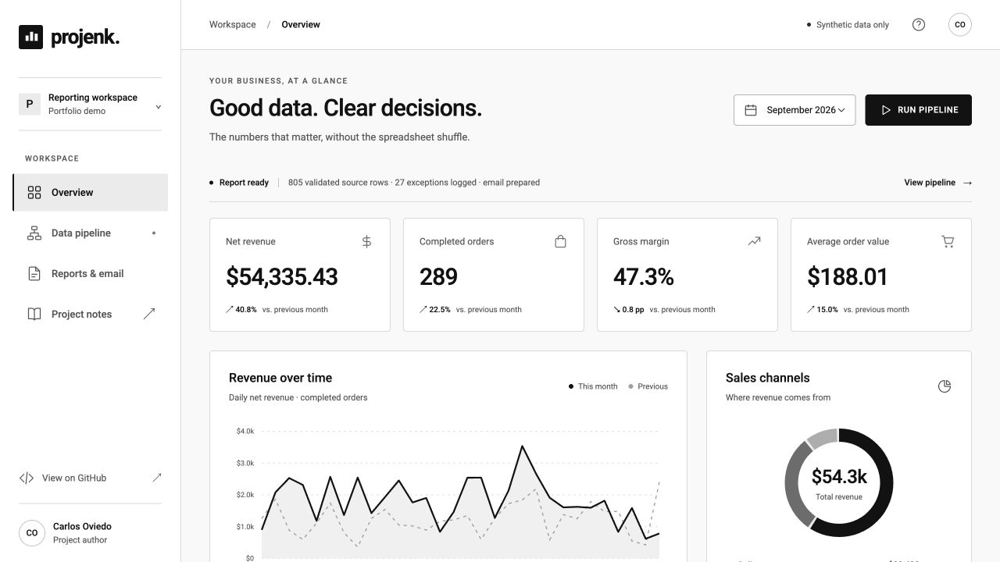
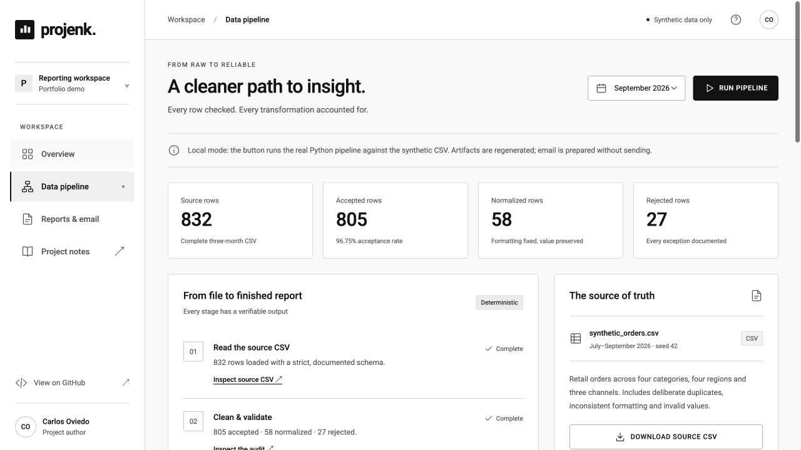
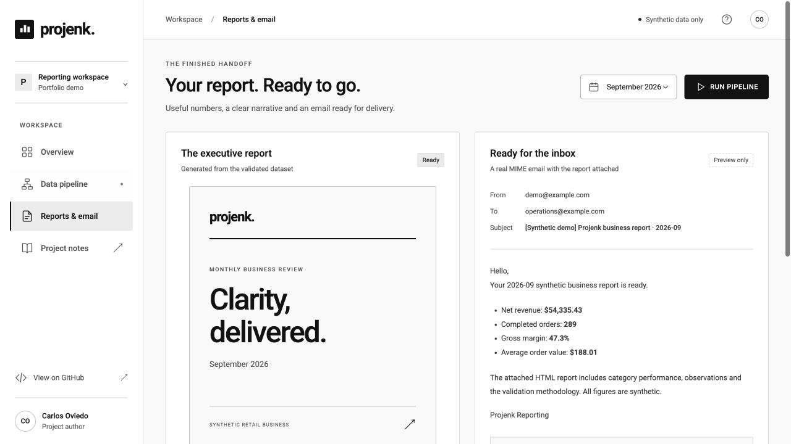

# Projenk · Automated business reporting

A complete, reproducible portfolio demo that turns imperfect synthetic CSV orders into validated data, business metrics, an executive report and a ready-to-send email.

**[Live demo](https://ovikrai.github.io/projenk-reporting-demo/)** · **[Executive report](https://ovikrai.github.io/projenk-reporting-demo/reports/2026-09/report.html)** · **[35-second demo video](https://ovikrai.github.io/projenk-reporting-demo/assets/demo.mp4)** · **[Source CSV](data/synthetic_orders.csv)**



## What this demonstrates

- Generate 832 repeatable synthetic orders covering July–September 2026.
- Normalize whitespace, casing and currency formatting; validate the schema and values.
- Retain 805 valid rows, normalize 58 of those rows, and log all 27 rejected rows.
- Calculate monthly revenue, orders, average order value, gross profit, margin and refund rate using decimal money arithmetic.
- Compare the current month with the previous calendar month.
- Generate a self-contained, printable HTML executive report and a MIME email with that report attached.
- Deliver through TLS-protected SMTP only when explicitly requested.
- Automate report generation in GitHub Actions and publish the portfolio to GitHub Pages.
- Explore a minimal black-and-white interface with flat Material-style controls and grayscale charts.

**All business data and observations are synthetic.** There are no real customers or transactions. The project replaces the former todo application; no old database or OAuth files are included in this GitHub repository.

## Run it in two minutes

Requirements: **Python 3.11+** and Git. No database, pip packages, Node build, API key or paid domain is required. Optional Node checks JavaScript syntax; optional FFmpeg rebuilds the demo video.

```bash
git clone https://github.com/ovikrai/projenk-reporting-demo.git
cd projenk-reporting-demo
python3 scripts/build_site.py
python3 main.py
```

Open **http://127.0.0.1:8000**. The local **Run pipeline** button executes Python and regenerates the selected month's artifacts. To change the port, use `python3 main.py --port 8001`.

You can also use `make serve`, `make report`, `make demo` and `make test`.

## Run the pipeline without the website

```bash
python3 -m reporting generate --output data/synthetic_orders.csv --seed 42
python3 -m reporting run --input data/synthetic_orders.csv --month 2026-09 --output output
python3 -m unittest discover -s tests -v
```

A run writes these artifacts:

| Artifact | Purpose |
| --- | --- |
| `cleaned.csv` | All valid, normalized source records across three months |
| `rejected.csv` | Excluded records' source line, order ID and reason |
| `audit.json` | Counts, normalization details, rejections and source SHA-256 |
| `metrics.json` | Selected-month metrics, groups and previous-month comparison |
| `report.html` | Executive report, category results and methodology |
| `report.eml` | Email preview with the actual HTML report attached |
| `run.json` | Dashboard-ready run snapshot and delivery status |

For the seeded September sample: **$54,335.43 revenue**, **289 completed orders**, **$188.01 AOV**, **47.3% gross margin**. Revenue grew **40.8%** versus August. These are reproducible demo outputs, not real business performance.

## Email the report

Default runs prepare an `.eml` file and **do not send anything**. Public previews use fictional `example.com` addresses. To prepare an email for your recipient:

```bash
python3 -m reporting run --month 2026-09 --to you@example.org
```

For actual delivery, export settings in your shell or supply them through your secret manager. `.env.example` documents the names; it is not loaded automatically. Keep credentials outside Git.

```bash
export SMTP_HOST='your-mail-server'
export SMTP_PORT='587'
export SMTP_SECURITY='starttls' # or ssl with port 465
export SMTP_USER='your-smtp-user'
export REPORT_EMAIL_FROM='reports@your-domain.example'
export REPORT_EMAIL_TO='your-recipient@example.org'
# Set SMTP_PASSWORD securely in your environment, not in committed source.
python3 -m reporting run --month 2026-09 --send
```

The mail provider may require an app password. Authentication is optional only when your TLS-protected relay permits it. The report is attached as HTML; open it in a browser and use **Print / Save PDF** for PDF export.

A successful local send writes a delivery receipt derived from the month, source hash, sender and recipient. Repeating the same delivery in the same output directory skips it. Concurrent sends use an exclusive lock. An uncertain failure keeps its lock: inspect the mail provider's sent log before removing it and retrying. SMTP acceptance is not proof of inbox delivery. Receipts are local to the output directory and are not a global or permanent deduplication system.

## Automation

Two workflows are included:

1. **Validate and publish portfolio** (`.github/workflows/pages.yml`): runs tests, checks browser JavaScript, rebuilds all three sample reports, and deploys `docs/` after pushes to `main`. Pull requests run validation without deploying.
2. **Automated business report** (`.github/workflows/report.yml`): runs each **Monday at 12:00 UTC / 8:00 AM Puerto Rico**, generates the September sample and stores preview artifacts for 14 days. A manual run lets you select a sample month.

Schedules intentionally reuse the fixed synthetic dataset. They do not represent fresh transactions. GitHub may delay scheduled runs and can disable inactive public-repository schedules; the manual workflow remains available.

For a manual live email, add repository Actions secrets `SMTP_HOST`, `SMTP_USER`, `SMTP_PASSWORD`, `REPORT_EMAIL_FROM` and `REPORT_EMAIL_TO`. Optional repository variables: `SMTP_PORT` and `SMTP_SECURITY`. Run **Automated business report** with `send_email` checked. Scheduled runs prepare previews only. Live email artifacts are kept out of the uploaded public preview artifact. A new manual workflow run is a new explicit delivery request; local receipts do not survive an ephemeral Actions runner.

## Publish to GitHub Pages

The included portfolio uses relative asset and report URLs, so it works under a repository subpath without a custom domain.

1. Push this project to a public GitHub repository with a `main` branch.
2. Open **Settings → Pages → Build and deployment**.
3. Choose **GitHub Actions** as the source.
4. Run **Validate and publish portfolio**, or push to `main`.
5. Open the deployment URL in the `github-pages` environment.

GitHub Pages serves static HTML, CSS, JavaScript and generated reports. On the public site, **Replay pipeline** walks through previously generated Python artifacts. Python execution and SMTP delivery happen locally or in GitHub Actions. [GitHub's custom Pages workflow documentation](https://docs.github.com/en/pages/getting-started-with-github-pages/using-custom-workflows-with-github-pages) describes the deployment mechanism.

When forking, update the repository and Pages links in `README.md`, `docs/index.html` and `scripts/build_site.py` to match your account.

## Data contract and cleaning rules

The CSV header must match this exact order:

```csv
order_id,order_date,category,region,channel,quantity,unit_price,unit_cost,discount_pct,status
```

| Field | Accepted values |
| --- | --- |
| `order_id` | 1–80 ASCII letters, digits, underscores or hyphens; first valid ID wins |
| `order_date` | Real date in strict `YYYY-MM-DD` format |
| `category` | Home & Living, Electronics, Apparel, Accessories |
| `region` | North, South, East, West |
| `channel` | Online, Retail, Wholesale |
| `quantity` | Integer from 1 to 10,000 |
| `unit_price`, `unit_cost` | Nonnegative USD; maximum 1,000,000; at most two decimal places |
| `discount_pct` | Numeric percentage from 0 through 100 |
| `status` | completed, refunded, cancelled |

The parser accepts UTF-8 with or without a BOM, quoted CSV fields, `$` currency prefixes and correctly grouped thousands. It trims whitespace and normalizes category, region, channel and status casing. It rejects ragged rows, malformed numbers, invalid enum values, impossible dates and duplicate IDs. A rejected first occurrence does not block a later valid occurrence of that ID. Source line numbers refer to CSV records, starting with the header as line 1.

Audit counts describe the complete input. Monthly metrics filter accepted rows by the reporting month. The seed deliberately adds three duplicate IDs and six independently invalid rows per month.

## Metric definitions

| Metric | Definition |
| --- | --- |
| Net revenue | Sum of completed orders: quantity × unit price × (1 − discount / 100), rounded per order to cents with `ROUND_HALF_UP` |
| Completed orders | Number of valid records with status `completed`; one CSV row is one order |
| COGS | Sum of completed-order quantity × unit cost |
| Gross profit | Net revenue − COGS |
| Gross margin | Gross profit / net revenue × 100 |
| AOV | Net revenue / completed orders, rounded to cents |
| Refund rate | Refunded orders / (completed + refunded orders) × 100 |
| Revenue, order and AOV changes | (Current − previous) / previous × 100 |
| Margin change | Current margin − previous margin, in percentage points |

Refunded and cancelled rows contribute zero revenue and zero COGS. This is a deliberately simplified full-order-refund model. Tax, shipping, partial refunds and operating expenses are outside scope. Zero denominators return zero metrics. Missing or zero previous-month baselines return `null` changes and display **No baseline**. July has no June baseline. The chart aligns calendar days; a prior month's extra final day is not plotted, while the KPI comparison includes both full calendar months. Rounded display percentages can sum to 101%.

## Architecture

```text
Seeded synthetic CSV
        │
        ▼
Python validation ─────► audit.json + rejected.csv
        │
        ▼
Cleaned rows ──────────► cleaned.csv
        │
        ▼
Decimal metrics ──────► metrics.json
        │
        ▼
Executive HTML ───────► report.html
        │
        ▼
MIME composition ─────► report.eml
        │
        └── explicit --send + environment ─► TLS SMTP + receipt

Site build ─► docs/reports/ + manifest ─► static portfolio ─► GitHub Pages
Local server POST /api/run ─► same Python pipeline
```

The former FastAPI/HTMX todo application is replaced by a dependency-free batch pipeline and a small local server. This makes the report generation easy to inspect and the portfolio compatible with static GitHub Pages hosting. Financial calculations have a single Python implementation; browser JavaScript only presents generated metrics and artifacts.

```text
reporting/           CSV generator, validation, metrics, report, email and CLI
scripts/build_site.py   Rebuild public artifacts for all sample months
scripts/make_video.py   Assemble screenshot tour with FFmpeg
main.py              Local HTTP server + real pipeline endpoint (localhost only)
data/                Synthetic source CSV
docs/                GitHub Pages portfolio, reports and media
tests/               Standard-library unittest coverage
.github/workflows/   Validation, Pages deployment and scheduled reports
```

## Screenshots and short demo

The screenshots are captured from the running application. The video is a 35-second screenshot walkthrough of the dashboard, data audit, report and portfolio, with English captions. It is a walkthrough, not a continuous screen recording.

| Overview | Data pipeline | Report and email |
| --- | --- | --- |
|  |  |  |

[Watch the demo video](https://ovikrai.github.io/projenk-reporting-demo/assets/demo.mp4) or open **Project notes → A quick tour** in the live site. Captions are in `docs/assets/demo.vtt`. To rebuild the video after replacing the screenshots, install FFmpeg and run `python3 scripts/make_video.py`.

## Verification and limits

Tests cover malformed and empty CSVs, normalization, duplicates, invalid dates and values, decimal rounding, zero denominators, previous-year comparisons, reproducible artifacts, HTML escaping, MIME attachments and mocked SMTP delivery/receipt behavior. The public UI is manually checked for navigation, month switching, pipeline replay, report downloads and mobile layout. Live email needs a configured mail provider; the default demo never claims an email was delivered.

A single source CSV and three months are deliberately sufficient for the demo. There is no authentication, live upload, analytics tracking or persistent business database. The local server binds to `127.0.0.1`; it is a development tool, not a production service.

Created by [Carlos Oviedo](https://github.com/ovikrai).
